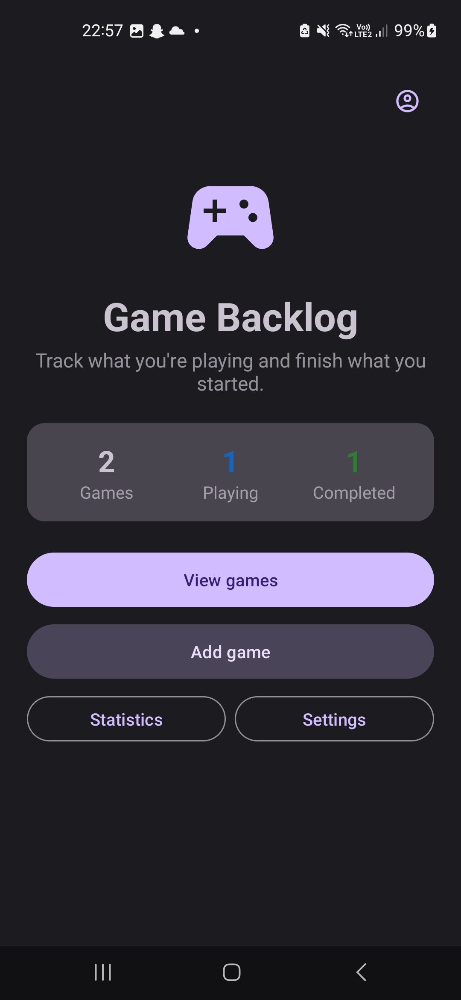
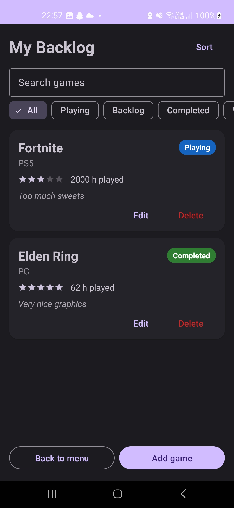
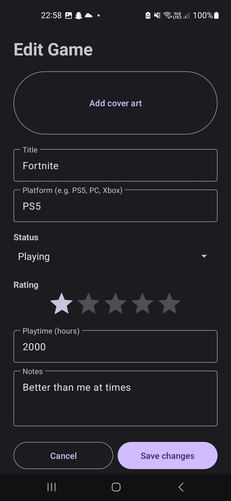

# Game Backlog Tracker
This an android application for keeping track of the games you want to play, are playing, and have finished. This is built in Kotlin with Android Studio for the Mobile Application Development 1 module

**Author:** Airidas Balkus

### CA1 Features
- View your backlog in a scrollable list of cards showinfg each game's title, platform, status, star rating, playtime and notes
- Add games with a title, platfrom, status of Wishlist, Backlog, Playing, Completed, Dropped, a 0 to 5 star rating, playtime in hours and free-text notes.
- Edit games: every field is pre-filled so you can update progress as you play.
- Delete games, with confirmation dialog to prevent accidenetal deletions.
- Backlog summary on the main menu showing total, playing and completed counts.
- Colour-coded status badges so you can scan the list at a glance.
- Input validation: a title is required and playtime must be a vaild number.
- Empty state message when the backlog has no games.
- Search games by title or platform as you type.
- Filter the list by status using chips (All, Playing, Backlog, Completed, Wishlist, Dropped); search and filter combine.

### CA2 Features (subject to change)
There is already small placeholders for these and show a simple message "coming soon" or "Linking Steam, PlayStation and Xbox accounts is coming in a future update"
- Sort the list
- Cover art for each game
- Statistic and Settings screens
- User profile with potential integration with Steam, Xbox and maybe even PlayStation

**NB** *Data is currently stored in memory, so games are cleared when the app is closed. Persitance is planned for CA2.*

## Screenshots
| Main menu | Game list | Add / edit |
|---|---|---|
|  |  |  |

## Architecture
The app separates data, UI layouts and UI logic:
- **Model:** `GameModel` (a Kotlin data class) and the `GameStatus` enum.
- **Persistence:** the `GameStore` interface defines the CRUD operations, implemented by `GameMemStore` using an `ArrayList` and an `AtomicLong` id generator. The `AppData` singleton exposes one shared store to every activity. Because the activities depend on the interface rather than the implementation, a file-based store can be swapped in later without changing the UI.
- **UI layouts:** XML layouts built with the Android Studio Layout Editor, using Material 3 components (cards, chips, outlined text fields).
- **UI logic:** `MainActivity` (menu and summary), `GameListActivity` (RecyclerView list), `AddEditActivity` (shared add/edit form) and `GameAdapter`, which binds games to cards and reports Edit and Delete taps back to the activity through callback functions.

Class, use case and sequence diagrams are in [docs/uml.md](docs/uml.md). They are written in Mermaid, so GitHub renders them as diagrams when you open the file.

## Running the app
1. Clone the repository and open it in Android Studio.
2. Let Gradle sync.
3. Run on an emulator or a device with Android 7.0 (API 24) or later.

## AI usage
AI assistance was used during this project. Details of what it was used for are in [docs/AI_USAGE.md](docs/AI_Usage.md).

## Built with
- Kotlin
- Android Studio Layout Editor
- AndroidX RecyclerView and AppCompat
- Material Components (Material 3)