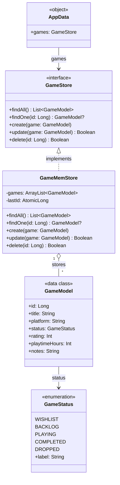
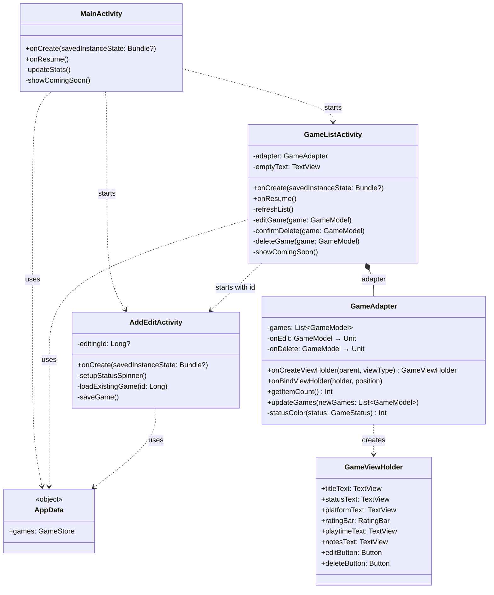
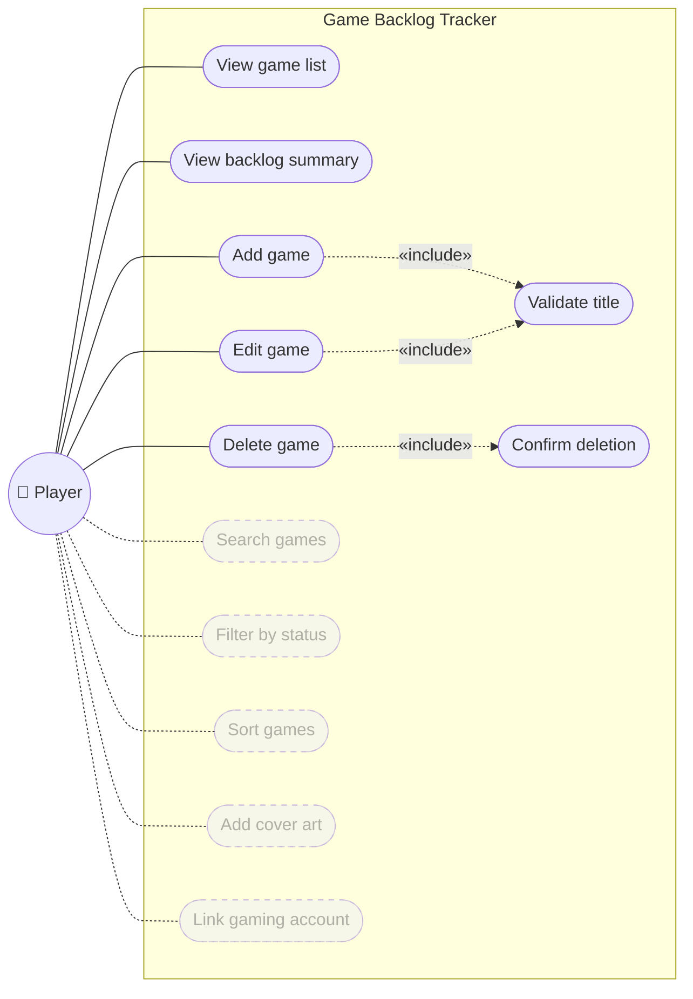
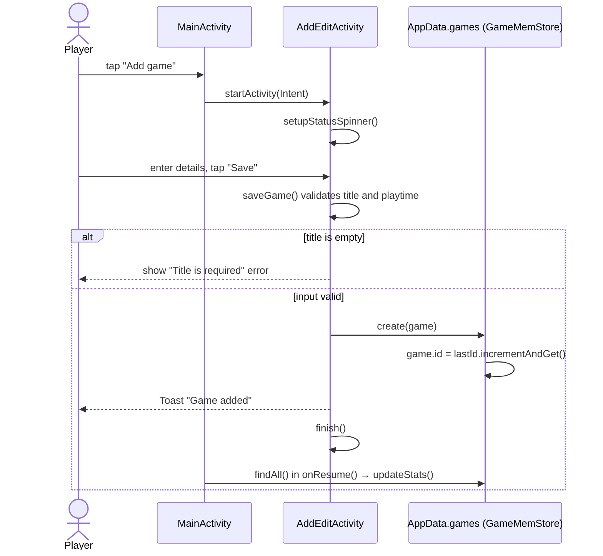
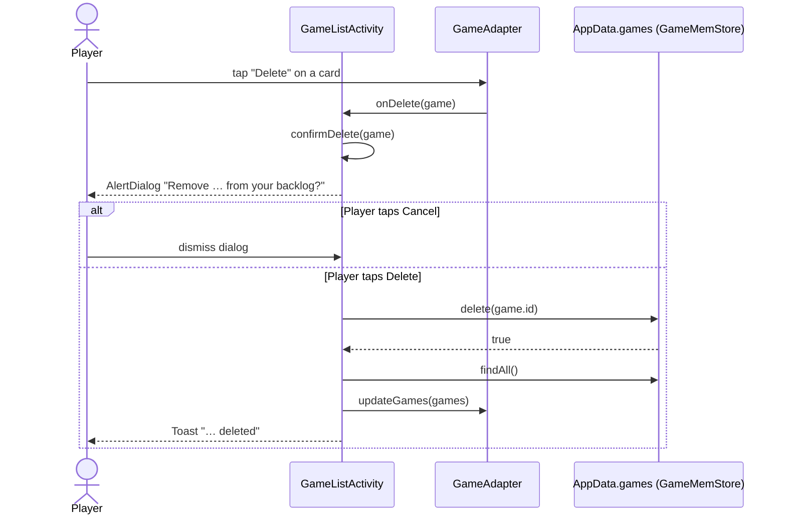

# UML Diagrams

These diagrams describe the Game Backlog Tracker as submitted for CA1. They are written in [Mermaid](https://mermaid.js.org/), which GitHub renders directly when you view this file.

## Class diagram

The app is split into three layers: the **model** (`GameModel`, `GameStatus`), **persistence** behind the `GameStore` interface (currently `GameMemStore`, shared through the `AppData` singleton), and the **UI** (three activities plus `GameAdapter` for the RecyclerView). The adapter does not modify data itself; it reports Edit and Delete taps back to `GameListActivity` through callback functions.

### Data layer

How games are modelled and stored. Activities only ever talk to the `GameStore` interface through `AppData`, so the in-memory store can be swapped for a persistent one in CA2 without changing the UI.

### UI layer

The three activities, the RecyclerView adapter, and how they connect to the data layer through `AppData`.

## Use case diagram

One actor, the player, manages their own backlog. Adding and editing both include title validation; deleting always includes a confirmation step. The dashed use cases are visible in the UI as placeholders and are planned for CA2.

## Sequence diagram: adding a game

## Sequence diagram: deleting a game

